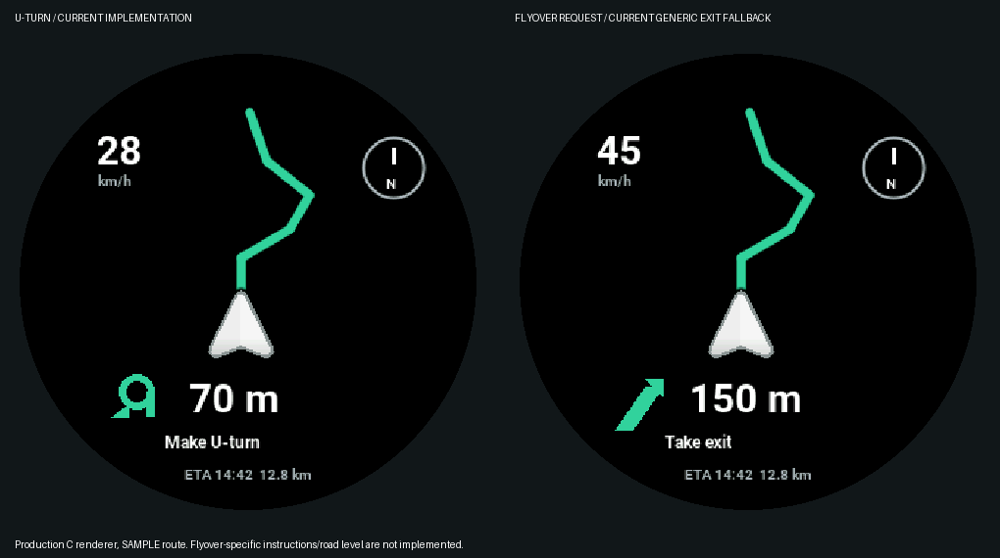

# Current navigation gaps — 4 November 2026

This review traces the companion app's provider mapping, maneuver state, BLE
encoding and the round firmware renderer. These are current code limitations,
not newly invented requirements. No additional navigation features were added.

| Confirmed gap | Code evidence and rider-visible consequence |
|---|---|
| Flyover/ramp identity and side are lost | App `lib/core/utils/maneuver_mapper.dart:19` maps both `RAMP_LEFT` and `RAMP_RIGHT` to `EXIT`. Firmware `main/display/round_ui.c` replaces ordinary instruction text with `action(direction)`, so even `Take flyover` renders `Take exit`. There is no dedicated flyover maneuver or road-level field in the BLE navigation model. |
| U-turn side and prominent alert are missing | App mapper maps `UTURN_LEFT` and `UTURN_RIGHT` to `U_TURN`, encoded as 8. Firmware has one fixed U-turn glyph in `display_tft.c`; `ride_ux.h` enables large blinking only for directions 2–7. Phone vibration similarly excludes U-turn. A basic static U-turn is supported; a distinct right U-turn or large blinking U-turn is not. |
| Roundabout exit information is lost | The mapper tests `ROUNDABOUT` before `EXIT`, so `ROUNDABOUT_EXIT` becomes `ROUNDABOUT`. The packet carries no exit number, and the round renderer shows a generic ring/action. It cannot tell the rider which numbered exit to take. |
| Nearby parallel/stacked roads are not distinguished reliably | `OffRouteDetector` compares two-dimensional `LatLng` geometry using a 50 m corridor. The local reproduction places the rider about 22 m beside the route and stays `onRoute` for eight accurate samples. A nearby service road may not trigger that detector. Altitude, bridge level and lane identity are not inputs; this does not prove every flyover will fail, but the implementation cannot resolve overlapping levels from those data. |
| Closely spaced following turn is not shown on the round device | The BLE packet and `navigation_data_t` retain next-direction/distance/text. `round_nav_t` and `round_ui_navigation()` receive/render only the current instruction. The app can advance through turns, but this screen offers no visible “then turn” preview. |

Four diagnostic reproductions passed in the separate app checkout:
`flutter test test/maneuver_gap_audit_test.dart` (ramp collapse, U-turn collapse,
roundabout-exit collapse and the 22 m parallel-road corridor case).
Passing these diagnostic checks confirms the gaps; it does not mean those cases
are correctly supported. The following-turn display omission is a source-trace
finding, not a simulated road test.

Both display areas are 466×466. The reference route and numbers are sample data;
the right panel intentionally shows today's generic exit fallback, not a fake
flyover-specific interface. Individual native PNGs are included with the package.

## Implemented display standby

The AMOLED now turns off after **15 seconds without touch or active use**. It
uses DCS Display Off/On (0x28/0x29), retaining power, brightness and the shadow
framebuffer. The firmware suppresses panel pixel transfers while off and restores
the full frame before turning the display on. It does not reset the board.

Touch anywhere on the panel wakes it, including outside the settings screen's
inscribed content area. The complete first contact is wake-only; a separate touch
operates buttons. An active ride, incoming call, OTA screen, playing music on the
music screen, or the ten-second arrival screen keeps it awake. An interrupted
active ride stays visible; Bluetooth loss is not treated as proof the ride ended.

BLE, touch polling, CPU and IMU remain running. This is **display standby**, not
ESP32 deep sleep or automatic light sleep. No measured current, battery life, or
physical touch/display wake result is claimed. True deep sleep would lose BLE;
ESP-IDF documents modem sleep plus automatic light sleep as another possible
connection-preserving power-management route, which is outside this change.

Checks cover the exact 15-second boundary, activity reset, active-use wake,
duplicate standby calls, both panel variants, blocked pixel transfers while off,
frame/brightness restoration, wake-only held touch and an isolated bad sample.
Both firmware targets cross-compile. Physical power and wake behavior still need
a bench test on the actual board.

- [ESP-IDF 5.5.5 sleep and Bluetooth restrictions](https://docs.espressif.com/projects/esp-idf/en/v5.5.5/esp32s3/api-reference/system/sleep_modes.html)
- [Official board documentation](https://www.waveshare.com/wiki/ESP32-S3-Touch-AMOLED-1.43)
