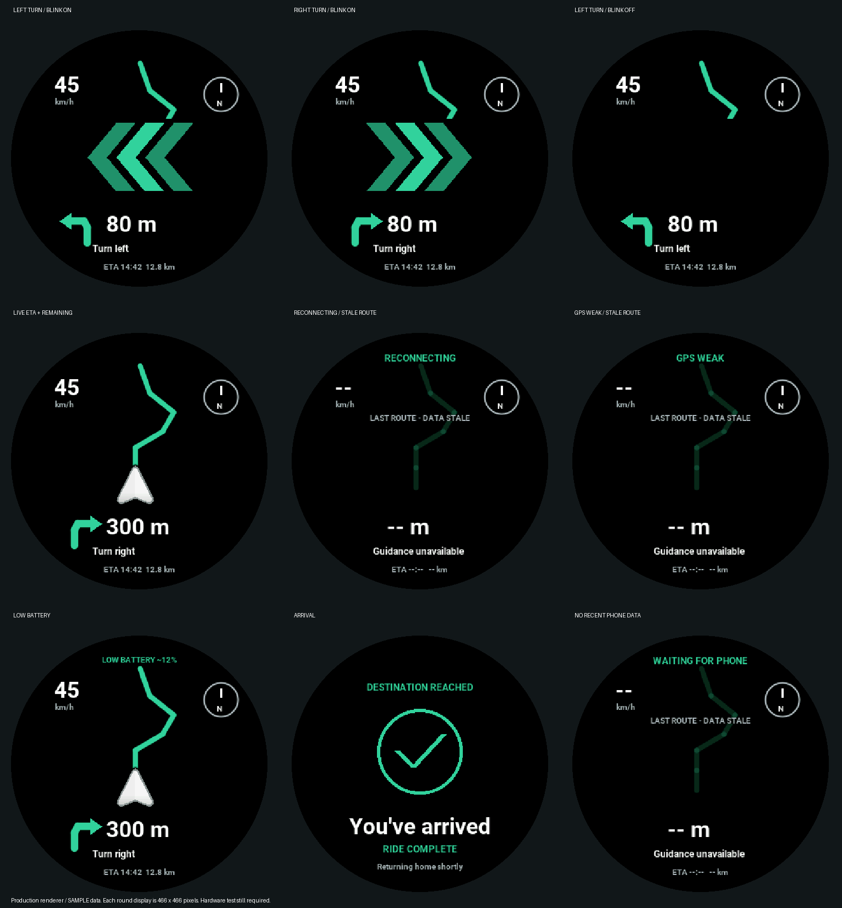
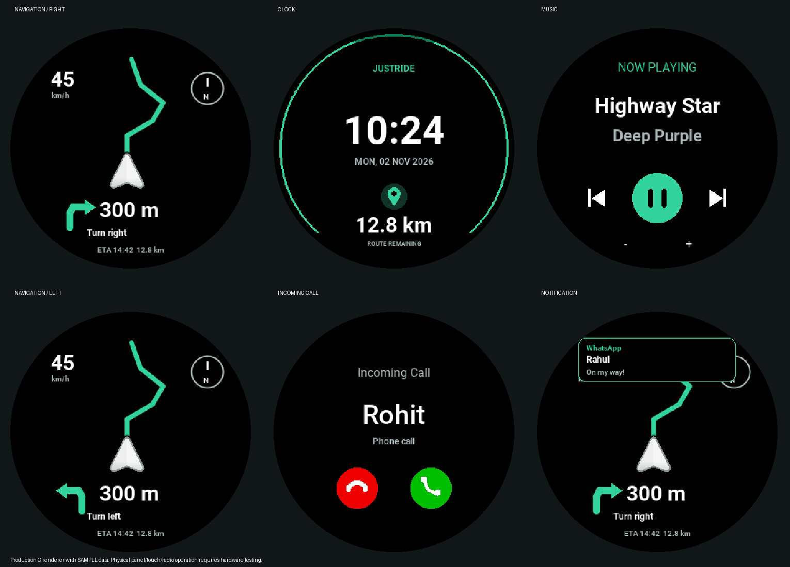

# Waveshare ESP32-S3-Touch-AMOLED-1.43

This branch adds the integrated **ESP32-S3R8 / 16 MB flash / 8 MB octal PSRAM**
board to the existing JustRide ESP-IDF firmware. It is different from the
RP2350 board and from the earlier bare 1.75-inch display.
Use its built-in BLE with the existing JustRide phone app.

## Screen and behavior

Navigation uses a black background, website-green (#34D399) phone-projected route, white rider
pointer, speed, left/right maneuver arrow, maneuver distance and status.
The firmware does not generate street tiles or substitute a sample route.
Waiting for route, GPS loss and phone disconnection remain explicit.
The clock, music, incoming calls and notifications have round layouts.
Image view, brightness, settings and OTA retain their existing 320×240 layout
inside a rectangle that fits entirely within the circular display; their touch
coordinates are mapped through the same transform.

### Riding experience

- Within 100 m of a left/right maneuver, three large **green chevrons** use the
  supplied reference silhouette, mirrored for right. They blink 500 ms on / 500
  ms off. The smaller direction arrow and distance remain visible during blink
  off. Completed maneuvers, overview, paused or unreliable guidance do not blink.
- The lower guidance panel includes arrival clock time (24-hour `ETA HH:MM`) and
  total remaining kilometres from the phone's existing route telemetry. A valid
  phone-synchronized clock is required for ETA; unavailable values show dashes.
- Disconnect shows `RECONNECTING`; service setup shows `SYNCING ROUTE`. No
  navigation packet for five seconds shows `WAITING FOR PHONE`. Old routes are
  dimmed and labelled `LAST ROUTE - DATA STALE`, with speed, turn distance and trip
  values hidden. A fresh valid packet restores guidance without a confirmation.
- The APK sends a navigation heartbeat every two seconds while a ride is active.
  This does **not** refresh an old GPS fix: fixes older than ten seconds or with
  accuracy worse than 50 m produce `GPS WEAK` on the display and suppress turn
  alerts. The existing longer phone GPS recovery loop continues in the background.
- `LOW BATTERY` appears on navigation at an estimated level ≤15%, only when supply
  measurements infer battery power. Five consecutive one-second low samples
  trigger one notification; it rearms after USB power or an estimate ≥20%. Missing
  measurements do not invent a warning. The APK power card also shows the warning.
- Confirmed arrival shows a **green checkmark**, `You've arrived`, and
  `RIDE COMPLETE`, then returns Home after ten seconds. Reconnecting at arrival
  no longer immediately sends a stop packet over that screen.
- APK Device Settings offers **Phone turn vibration**, off by default and saved
  on the phone. It uses native haptic feedback once per nearby left/right maneuver,
  checks GPS freshness, and suppresses repeats, pause, rerouting and completed turns.
  Phone haptic settings/hardware determine whether vibration is perceptible.



[Left turn blink, native 466×466](docs/previews/turn-left-blink-466.gif) ·
[Right turn blink, native 466×466](docs/previews/turn-right-blink-466.gif) ·
[Arrival, native 466×466](docs/previews/arrival-native.png).
The preview's outside margin is decorative; the actual panel is 466×466.
The firmware retains its existing 320×320 logical drawing canvas and maps it
through the production panel transform. No photograph or hardware timing is claimed.




These are captures of production C drawing functions rendered into a host
framebuffer, scaled with the same integer mapping used by the panel transport.
The numbers, caller, track and route in these previews are test fixtures.
They do not demonstrate a live GPS fix or physical screen/radio operation.

The existing BLE UUIDs and navigation/media/call/OTA packet layouts are retained.
The phone calculates navigation and sends the route window; the IMU affects the
visual pointer using the existing filtering/calibration pipeline. It does not
replace GPS speed or change the phone's route.
The clock retains the existing phone synchronization and NVS checkpoint behavior;
the onboard PCF85063 is not used for battery-backed calendar recovery in this port.
The SD card is not needed by the current firmware.

## Touch

- Swipe between the existing screens.
- Navigation double-tap zooms in. Double-tap, keep the second press down and drag
  vertically for zoom in/out. This reuses the established five phone camera levels.
- Tap the speed area at upper left for route overview; tap the compass to recenter.
- Call/music buttons send the existing BLE commands only when the phone reports
  that the corresponding action is available.
- The FT3168 path accepts one valid contact. It does not claim two-finger pinch.

## Onboard wiring

These connections are already on the PCB; do not wire it as an external 2.8-inch TFT.

| Function | ESP32-S3 GPIO |
|---|---|
| QSPI CS / CLK | 9 / 10 |
| QSPI D0 / D1 / D2 / D3 | 11 / 12 / 13 / 14 |
| AMOLED reset / enable | 21 / 42 |
| I2C SDA / SCL | 47 / 48 |
| FT3168 touch | I2C 0x38 |
| QMI8658 motion sensor | I2C 0x6B |
| Native USB D− / D+ | 19 / 20 |

One I2C driver owns GPIO47/48. Touch and IMU share complete serialized ESP-IDF
transactions; the old MPU6500 GPIO21/22 probing/reset routine is excluded on S3.
QMI8658 samples are decoded little endian with ±2g / ±512dps scales.

### Gyroscope turning

The S3 path projects all three gyro axes onto gravity measured during stationary
calibration, so turning also works with an upright mounted display. It subtracts
the measured bias and integrates the clockwise turn at the existing 50 Hz task
rate. Left/right turn rate and relative yaw are sent to the APK. A read error or
stale sample stops the pointer from using that reading. Moving calibration windows
are rejected and retried instead of disabling the gyro. Recalibration resets yaw.

This is relative rotation, not a magnetic compass: drift is possible. GPS and the
phone still own the route, speed and upcoming maneuver. Keep still during
calibration. Verify left/right on the actual mounting before riding; menuconfig
provides `JR_GYRO_INVERT_TURN` if the assembly needs the opposite sign.

### Stock charging hardware and measured voltage

The onboard ETA6098 charges the battery autonomously. Its STAT output drives an
LED and is **not connected to an ESP32 GPIO**. No extra wire is required by this
implementation, and it always reports charging/full as **unavailable**.

The schematic's BAT_ADC name is misleading: GPIO4 measures **VCC**, through
R12=200 kΩ and R17=100 kΩ, so VCC = calibrated ADC voltage × 3. USB power raises
this rail through the supply diode; it is not battery voltage in that condition.
The firmware samples once per second, removes the highest/lowest of 16 samples,
uses the ESP-IDF calibrated ADC conversion and publishes every five seconds.
Calibration/read failure reports unknown instead of a fabricated voltage.
`JR_POWER_GAIN_PERMILLE` permits a measured divider correction (default 1000).

The APK shows supply voltage and an explicitly inferred power source. Only a
battery-range rail receives a rough voltage-based percentage, labelled `~`;
USB or ambiguous readings have no battery percentage. This is not a fuel gauge,
and battery load/chemistry affect the estimate. APK readings expire after 15
seconds without a valid packet and clear on disconnect.

### APK telemetry contract

FF32 capability read is `[1,3,7,9]` on this board: feature bit 4 advertises power
telemetry, and byte 4 is the ESP image chip ID (9 = ESP32-S3). The original ESP32
retains `[1,3,3]`. The updated APK selects a separate S3 bundled firmware image
and rejects a chip-ID mismatch before sending OTA START.

Write `[0x1D,0]` to FF31 to request power. FF32 notifies ten bytes:
`[1D,1,flags,source,charge,percent,VCClo,VCChi,BATlo,BAThi]`.
Flags: bit 0 voltage valid, bit 1 battery estimate valid. Source: 0 unknown,
1 battery inferred, 2 USB inferred. Charge is always 255 (unknown); percent is
255 when unavailable. Voltage is little-endian millivolts; BAT is zero unless
estimated on battery power. USB inference starts at 4.45 V and persists down to
4.35 V; battery inference covers 3.00–4.30 V. Other valid rails remain unknown.

Sensor FF32 v2 is `[1A,2,state,motion,rollLE16,pitchLE16,yawLE16,rateLE16,flags]`.
Angles and rate are signed tenths of degrees and degrees/second. Gyro flag bit
0 means available, bit 1 fresh. The old eight-byte v1 remains on the ESP32 path;
the updated APK parses both. These diagnostic extensions fit the default BLE MTU.

The official V3 demo detects SH8601 with ID 0x86 and CO5300 with ID 0xFF.
The port uses that procedure and the corresponding vendor startup sequence:
SH8601 X offset 0; CO5300 X offset 6. Unknown IDs stop initialization.
Under **menuconfig → JustRide board**, a panel variant can be forced if the
automatic read is not usable on the actual assembly. Touch swap/mirror options
are available there for bench calibration; defaults preserve native coordinates.
An ID read alone cannot prove that a panel is connected or displaying correctly.

The panel shadow framebuffer uses 434,312 bytes of PSRAM. Changed rows are copied
through a fixed internal DMA buffer and sent over QSPI with even-row alignment.
No new allocation happens during normal route redraws.

## Build and flash

Use an ESP-IDF **5.5.5** terminal with its installed Python/toolchain activated.
Do not reuse an ESP32 build directory or flash the old ESP32 image onto this S3.

```powershell
idf.py -B build-s3 set-target esp32s3
idf.py -B build-s3 build
idf.py -B build-s3 -p COMx flash monitor
```

The supplied defaults select 16 MB flash, octal PSRAM, USB Serial/JTAG console,
NimBLE and the original dual-OTA partition layout. The partition table deliberately
retains its original offsets and uses only the first 4 MB of the 16 MB flash.
The old 320×240 user-image protocol remains compatible.

On boot, the terminal reports the selected panel and touch/IMU initialization.
NimBLE prints **BLE MAC Address: ...** after stack synchronization. Pair that real
address using the existing app. A new physical board has a different address
from the old display and may need the app's normal pairing/provisioning flow.
No fabricated MAC or registration bypass is added.

For the original 2.8-inch ESP32 profile, use a separate configuration:

```powershell
idf.py -B build-2.8 "-DIDF_TARGET=esp32" "-DSDKCONFIG=sdkconfig.esp32" "-DSDKCONFIG_DEFAULTS=sdkconfig.defaults.esp32" build
```

## Reproducible checks

Windows host checks need Python with Pillow and MSVC Build Tools:

```powershell
python tools/test_waveshare143.py
python tools/preview_round.py
python tools/test_touch.py
python tools/test_zoom.py
```

The board test compiles the actual QSPI transport and FT3168 driver against mocked
I/O. It checks both panel offsets, fragmented writes, DMA alignment, dirty-row
suppression, image-pane mapping, touch release and I2C failure handling.
It also checks stock divider conversion, USB/unknown behavior, monotonic battery
estimates, exact power packets and gravity-projected turning/integration/wrap.
The preview tool checks round hitbox mapping, FT3168 reports, QMI8658 signed
samples, splash animation boundaries and changing maneuver output.
The existing touch suite checks 392 driver/gesture cases.

Build/tests establish source and binary consistency. A bench test is still needed
for actual panel model, touch orientation, color order, IMU axes, BLE connection,
brightness, restart behavior and OTA rollback. Neither host previews nor a passing
cross build establishes those electrical/runtime results.

## Hardware references

- [Official Waveshare board wiki and pinout](https://www.waveshare.com/wiki/ESP32-S3-Touch-AMOLED-1.43)
- [Board schematic](https://files.waveshare.com/wiki/ESP32-S3-Touch-AMOLED-1.43/ESP32-S3-Touch-AMOLED-1.43-Schematic.pdf)
- [Official V3 demo used for register/pin verification](https://files.waveshare.com/wiki/ESP32-S3-Touch-AMOLED-1.43/ESP32-S3-AMOLED-1.43-Demo-V3.zip)
- [FT3168 datasheet](https://files.waveshare.com/wiki/common/DATA_SHEET_FT3168.pdf)
- [QMI8658 datasheet](https://files.waveshare.com/wiki/common/QMI8658C_datasheet_rev_0.9.pdf)
